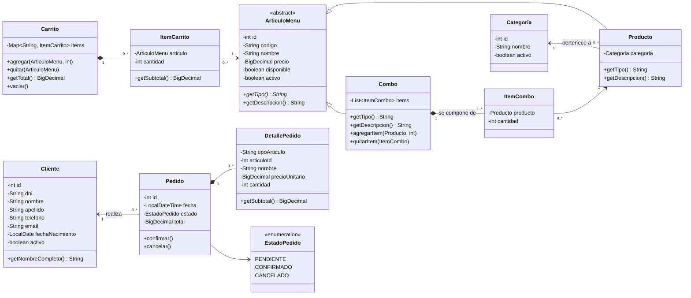
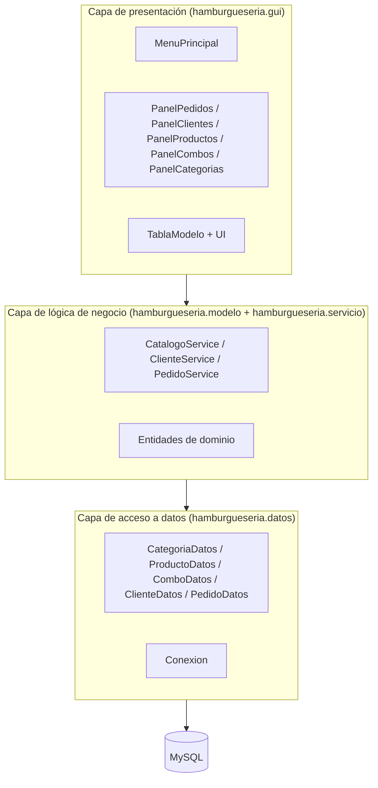
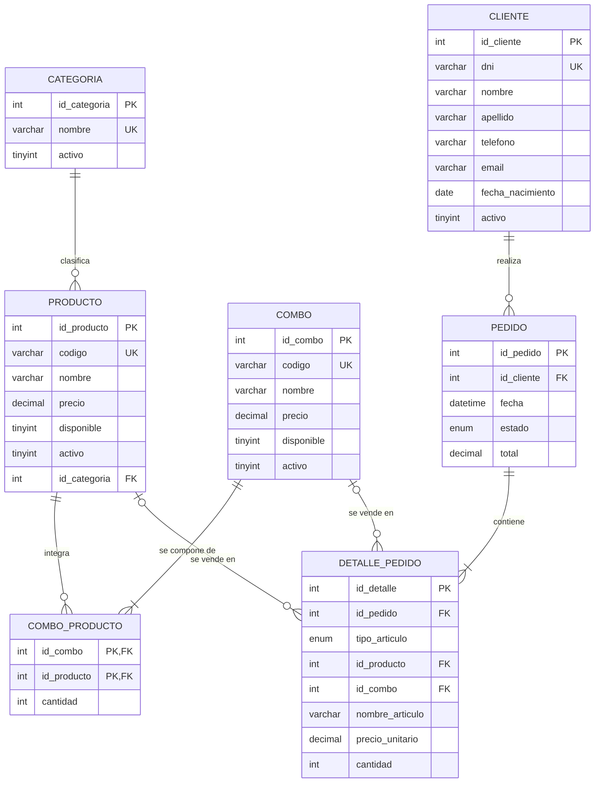

# Documentación del diseño

Los diagramas están en formato [Mermaid](https://mermaid.js.org/): se ven renderizados
en GitHub, en VS Code (extensión "Markdown Preview Mermaid Support") y se pueden
exportar a PNG/SVG pegando el código en <https://mermaid.live>.

## 1. Diagrama de clases (capa de dominio)

## 2. Arquitectura en capas

## 3. Diagrama Entidad-Relación (DER)

**Relaciones:**

| Relación | Tipo |
|---|---|
| Categoría — Producto | 1 a N |
| Combo — Producto (vía `combo_producto`) | N a M |
| Cliente — Pedido | 1 a N |
| Pedido — Detalle de pedido | 1 a N |
| Detalle — Producto / Combo | N a 1 (exactamente uno de los dos, validado con `CHECK`) |

## 4. Elementos de base de datos exigidos

| Elemento | Dónde |
|---|---|
| Stored procedures | `sp_crear_pedido`, `sp_agregar_detalle`, `sp_cambiar_estado_pedido` (llamados desde `PedidoDatos`) |
| Triggers | `trg_detalle_bi` (solo pedidos pendientes), `trg_detalle_ai` (recalcula el total), `trg_pedido_bu` (reglas de estado), `trg_categoria_au` (baja de categoría deshabilita sus productos) |
| Transacciones | `PedidoDatos.registrar` / `cambiarEstado` (commit/rollback) y `ComboDatos.insertar` / `actualizar` |
